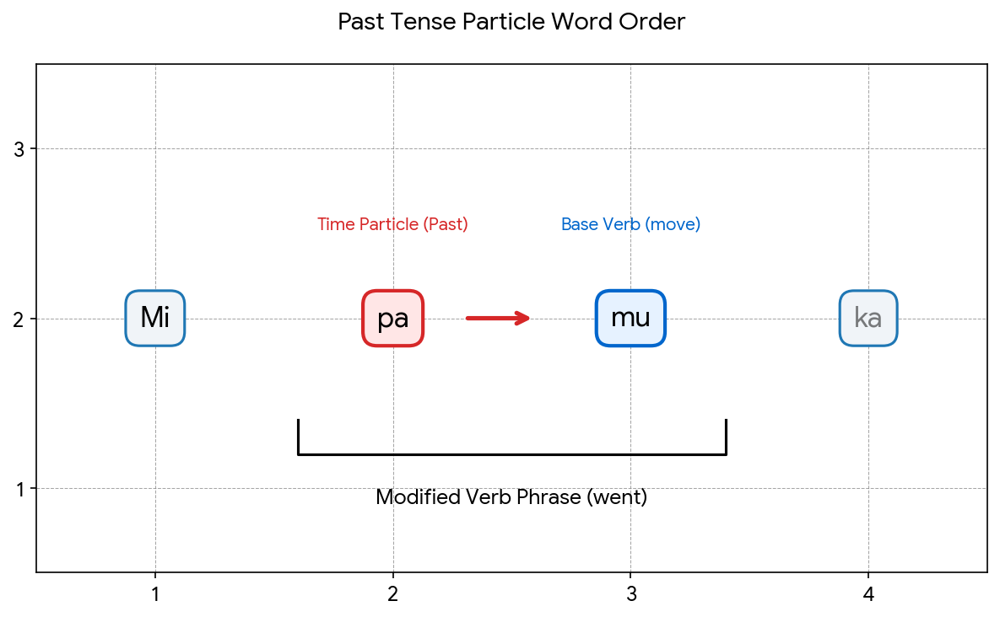

  

   <h3>Lita</h3>

   A auxlang made for easy use.
    
   
   [![Report a bug][issue-badge]][issue-link] &nbsp;&nbsp;&nbsp;&nbsp; [![Feature request][features-badge]][features-link] &nbsp;&nbsp;&nbsp;&nbsp; [![License][license-badge]][license-link]

# Overview

Lita is a language designed to be comfortable to speak and fluid to write. Its overall structure is intuitive and built for real-world use, featuring a simplified grammar that allows for quick learning.

By eliminating verb conjugations, singular or plural concepts, articles, and prepositions, Lita can be mastered in just a week or two. Additionally, the language follows a strict **consonant-vowel** pattern, ensuring a smooth, natural flow when spoken.

# Language

## 1. Phonology

### 1.1 Consonants IPA Chart

| Manner of Articulation | Bilabial  | Alveolar  |  Velar   |
| :--------------------- | :-------  | :-------  | :------- |
| Plosive                | /p/, /b/  | /t/, /d/  | /k/, /g/ |
| Nasal                  | /m        | /n/       |          |
| Fricative              |           | /s/       |          |
| Glide                  |           | /l/       |          |

### 1.2 Vowel IPA Chart

Lita has a 5-vowel system. All vowels are monophthongs, spoken with short duration.

| Vowel Height | Front    | Back     | 
| :----------- | :------- | :------- |
| Close (High) | /i/ (ee) | /u/ (oo) |
| Mid          | /e/ (eh) | /o/ (oh) |
| Open (Low)   | /a/ (ah) |          |

### 1.3 Phonotactics & Syllable Format

The language enforces a strict syllable structure to achieve rapid, staccato rhythm (some sounds flow though).

**Syllable Matrix:** CV (Exactly one Consonant followed by exactly one Vowel)

**Allowed Syllables:** ka, ti, mu, sa, etc.

**Phonological Total:** 10 Consonants × 5 Vowels = 50 single-syllable words (two more for form particles)

## 2. Orthography & Script

Lita uses an original, native Fluid Logographic Cursive Script (FLCS) designed to minimize pen-lifts and maximize compression. These 50 roots represent the complete baseline words of Lita.

*You can see the script in the preview, this is romanized Lita*

| Word | Meaning                                 |
| :--- | :-------------------------------------- |
| mi   | I / Me / Myself / 5                     |
| yo   | You / Yourself                          |
| lu   | They / Them / Plural Marker             |
| pe   | Person / Human                          |
| ka   | House / Room / Building / Container / 4 |
| so   | Tool / Object / Physical Device         |
| lo   | Land / Earth / Ground / Location        |
| ba   | Water / Liquid / Flow                   |
| sa   | Fire / Heat / Light / Energy            |
| di   | Air / Sky / Weather / Gas               |
| tu   | Food / Nourishment                      |
| na   | Mind / Data / Information               |
| li   | Life / Living Being / Organism / 7      |
| ta   | Sound / Signal / Speech                 |
| ki   | Time / Moment / Clock / Now             |

### Verbs & Kinetic Operations

| Word | Meaning                      |
| :--- | :--------------------------- |
| mu   | To go / Move / Walk / Travel |
| ma   | To eat / Consume / Use up    |
| te   | To take / Get / Receive      |
| do   | To give / Transfer outward   |
| baoa | To drink                     |
| naoa | To know / Think / Process    |
| taoa | To speak / Say / Communicate |
| lioa | To see / Look / Perceive     |
| kioa | To make / Build / Create     |

### Modifiers and particles

| Word | Meaning                           |
| :--- | :-------------------------------- |
| ja   | First Form Marker                 |
| la   | Second Form Marker                |
| pa   | Past Tense marker                 |
| fu   | Future Tense marker               |
| no   | Negation particle                 |
| ko   | Interrogative particle            |
| bi   | Augmentative / Big / Very / Much  |
| si   | Diminutive / Small / Little / Few |

### Meta-concepts, Logical Operators & Abstract States

| Word | Meaning                                             |
| :--- | :------                                             |
| se   | To be / Exist / Equal                               |
| seoa | State / Condition / Quality / Property              |
| teoa | Space / Area / Dimension / Scope                    |
| pi   | System / Network / Structure / 6                    |
| po   | Law / Rule / Order / Authority                      |
| pu   | Value / Cost / Trade / Asset                        |
| ti   | Point / Focus / Target / Specificity / Identity / 1 |
| to   | Group / Set / Category / Type / 8                   |
| da   | Change / Transformation / Shift                     |
| de   | Relation / Link / Connection / Network / 2          |
| du   | Cause / Region / Logic / Source                     |
| ga   | Part / Piece / Fraction / Component / 3             |
| ge   | Whole / Total / Universe / Completion / 9           |
| go   | Agreement / True / Positive State                   |
| gu   | Disagreement / False / Error State                  |
| gi   | Stochasticity / Entropy / Chaos                     |
| ku   | Void / Latency / Null-Space / 0                     |
| su   | Equilibrium / Homeostatis                           |
| ne   | Recursion / Fractal / Feedback                      |
| mo   | Paradigm / Model / Simulation                       |

## 3. Grammar Syntax

Lita rejects morphological updates (no prefixes/suffixes, inflections, or conjugations).

### 3.1 Strict Word Order

Sentences must strictly follow this precise structure:

Sentence → [T₁] + Subject + [T₂] + Verb + [T₃] + Object + [Interrogative]

The <i>Time Particle</i> may occupy any position <mark>T₁</mark>, <mark>T₂</mark>, or <mark>T₃</mark>.

### 3.2 Modifier Rules

Descriptive modifiers (adjectives and adverbs) always follow the root word they modify

**Noun + Modifier:** ka (house) + sa (fire) = kasa (oven)

**Verb + Modifier:** mu (move) + bi (big) = mubi (To run / sprint)

### 3.3 Tense Operations

Tense is determined by the Time Particle that is inside a SVO sentence.

**Present:** Mi mu ka (I go to the house)

**Past:** Mi pa mu ka (I *Past tense marker* + go to the house = I went to the house)

**Future:** Mi fu mu ka (I *Future* + go to the house = I will go to the house)

A time particle must be placed directly before the word it modifies to change it to the past tense. For example of a verb, in the phrase "Mi pa mu ka," the particle "pa" is positioned right before "mu" (move) to turn it into the past tense "went."

<figure>
  
  <figcaption align="center"><i>AI-generated image, but you get the idea</i></figcaption>
</figure>

### 3.4 Negations & Questions

**Negation:** The particles *no* directly precedes the verb or operation it negates.
*e.g.* Mi no ma tu (I don't eat food.)

**Questions:** The particle *ko* closes the sentence to instantly create a question without changing word order.
*e.g.* Yo na mi ko? (You know me *[question particle]* = Do you know me?)

### 4. Radical Compounding

Because Lita features an ultra-compressed core lexicon, complex words are generated by combining the 50 words.
You can arrange words in any order, provided the sentence flows well and is easy to pronounce; however, you cannot alter the internal structure or form of the existing words.

  <h4 style="margin: 0 0 8px 0; font-family: sans-serif; font-size: 0.85em; text-transform: uppercase; letter-spacing: 1px; opacity: 0.5;">
    A Classic Children's Rhyme
  </h4>

  <h3 style="margin: 0 0 2px 0; color: inherit; font-size: 1.2em;">
    <strong>Simuka mu Bika</strong>
  </h3>
  

    (The Tiny Car Goes to the Big House)
  

  

    Simuka mu lo si,
    Bika mu, fu mu mi.
  

  

    Mi lila yo, yo lila mi,
    Na tu lo li se si!
  

  

    Little car goes down the track,
    To the big house, then right back.
  

  

    I see you, and you see me,
    Eating food under the tree.
  

  

    <strong style="display: block; margin-bottom: 4px; text-transform: uppercase; letter-spacing: 0.5px;">Vocabulary Breakdown:</strong>
    <ul style="margin: 0; padding-left: 16px; list-style-type: disc;">
      <li style="margin-bottom: 2px;"><strong>Simuka:</strong> Si (small) + mu (to go) + ka (container)</li>
      <li style="margin-bottom: 2px;"><strong>Bika:</strong> Bi (big) + ka (house)</li>
      <li style="margin-bottom: 2px;"><strong>Fu mu mi:</strong> Fu (future tense marker) + mumi (back)</li>
      <li style="margin-bottom: 2px;"><strong>Mi lila yo, yo lila mi:</strong> I see you, you see me</li>
      <li style="margin-bottom: 0;"><strong>Ma tu lo li se si:</strong> Eating food under the tree</li>
    </ul>
  

# Contributing

See __CONTRIBUTING.md__.

# Code of Conduct

See __[CODE_OF_CONDUCT.md](CODE_OF_CONDUCT.md)__

# License

Copyright (c) _2026_, _CoderTheSheriff (karuman2013@gmail.com)_,  
with Reserved Font Name _Lita_. 

This font software is released under the **SIL Open Font License, Version 1.1**, the full text of which can be found in the accompanying [LICENSE](LICENSE.md) file. Under this license, you are free to use, study, modify, and redistribute this font for both personal and commercial projects, and you may freely embed it into websites, applications, and documents. However, you cannot sell the font files completely by themselves—they must be bundled with other software or creative works. Additionally, any modified or derivative versions of this font must remain under this same license, and they cannot use the original Reserved Font Names without explicit written permission.

[issue-link]: https://github.com/CoderTheSheriff/Lita/issues/new?assignees=&labels=&template=BUG-REPORT.yml
[features-link]: https://github.com/CoderTheSheriff/Lita/issues/new?assignees=&labels=&template=FEATURE-REQUEST.yml
[license-link]: https://github.com/CoderTheSheriff/Lita/blob/main/LICENSE.md

[issue-badge]: https://img.shields.io/badge/Report%20a%20bug-red?style=for-the-badge&logo=github
[features-badge]: https://img.shields.io/badge/Feature%20request-blue?style=for-the-badge&logo=github
[license-badge]: https://img.shields.io/badge/license-SIL%20OSL-success?style=for-the-badge
